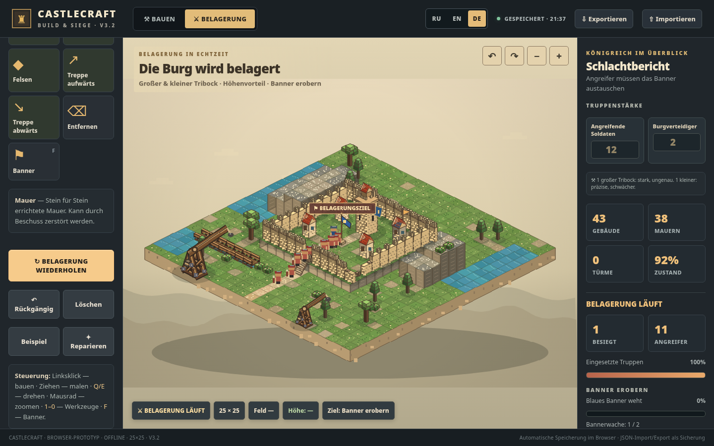

# CASTLECRAFT v3.2 — Twin Trebuchets, Bridges & Troop Control

A self-contained offline **25 × 25** medieval castle-builder and siege prototype in a single HTML file. No game engine, downloads or web services are required. Open `Castlecraft_Siege.html` in a modern desktop browser.

## Features

- **25 × 25** editable island with stone walls, towers, gates, a keep, houses and barracks.
- Terrain tools: cliffs, height editing (0–4), 3D stone stairs with adjustable facing, roads, ponds and **walkable wooden bridges**.
- Three plant types: fir trees, broadleaf trees and small shrubs.
- Exactly two animated counterweight **trebuchets** in siege mode:
  - **Heavy**: large projectile, blast damage over a wider area, high inaccuracy.
  - **Light**: smaller projectile, more accurate and lower damage.
  - No ballistas or other siege machines.
- Editable **troop counts** (default 8 attackers and 4 defenders; attackers 1–60, defenders 0–24) plus difficulty modifiers.
- RU / EN / DE user interface.
- Defenders hold the banner, invaders must lower it and raise theirs to win.
- Persistent autosave and JSON export/import. Supports 14×14, 20×20 and 25×25 maps from v1, v2, v3 and v3.1. v3.2 export includes bridges and troop settings.

## Controls

- **Left click:** place the selected building or terrain feature.
- **Drag:** paint walls, plants, bridges, roads, water and terrain.
- **Q / E:** rotate camera; **mouse wheel** or +/-: zoom.
- **1–0:** first 10 tools; **F:** banner.
- In siege: use Pause, Restart or Return to construction.

## Technical implementation

- Offline HTML, CSS and JavaScript. Custom Canvas 2.5D isometric renderer with procedural meshes, masonry, foliage and wooden bridge details.
- Dijkstra-style path planning incorporating obstacles, cliffs, stairs and bridge traversal.
- Simple animated trebuchet arms, sling and counterweight, ballistic-looking projectiles, impact splash damage, particles and debris.
- Architecture, pathfinding and combat behavior are stylized prototype mechanics, **not an engineering-accurate structural or ballistic simulator**.
- Source is editable directly in the HTML file.

## Notes

- The castle-demo map is intentionally designed with a raised plateau and one staircase. Bridges can be painted across water, then crossed by infantry if the banks are accessible.
- To back up a build, use **Export** and keep the JSON file.
- In a private/incognito browser session, local browser storage might not persist. Use JSON export as a backup.

## Version and licensing

This archive contains **v3.2 (25 × 25 map)**, not a later 40 × 40 build. **No project license is included**. Choose the intended software and illustration licenses before accepting outside contributions or granting reuse.
